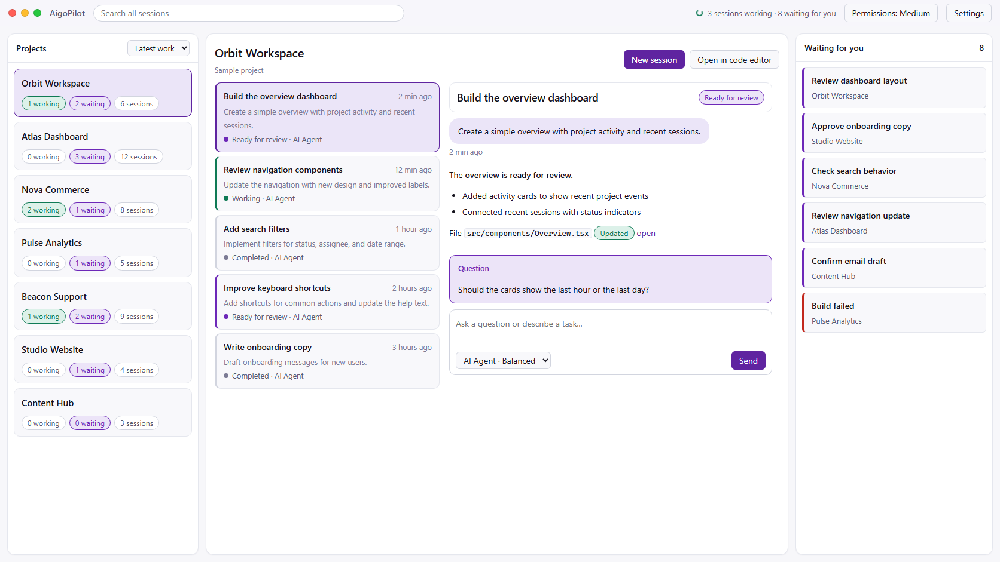
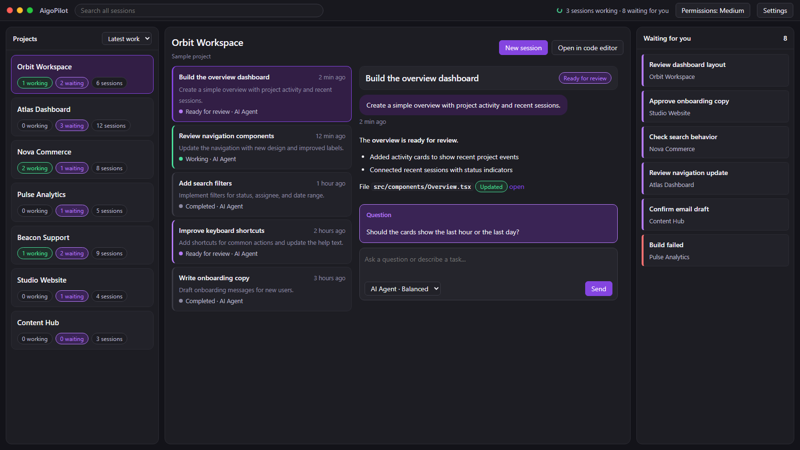

# AigoPilot

**One desktop studio for Claude Code, Codex and Grok. Every project, every session, one window.**

AigoPilot gathers your AI coding sessions in one place. You see which ones are working, which finished and which are waiting for your answer, across all your projects, without digging through terminals. It runs on Windows, macOS and Linux.

[Website](https://aigopilot.com/) · [Getting started](docs/getting-started.md) · [Release notes](docs/release-notes.md) · [User guide](https://aigopilot.com/guide) · [Support](docs/support.md)

*Sample projects and conversations. The interface may differ slightly between versions.*

## Current release

**Version 0.1.0, build of 30 October 2026 (AigoPilot 1.989 in Settings).** The studio is on sale for Windows, macOS and Linux. See [what is new](docs/release-notes.md).

| | Download |
|---|---|
| Studio for Windows 10 and 11 (64-bit) | From your account on [aigopilot.com](https://aigopilot.com/) after purchase |
| Studio for macOS 13.3 or newer (Apple silicon) | From your account on [aigopilot.com](https://aigopilot.com/) after purchase |
| Studio for Linux (x86_64, AppImage or .deb) | [Installing on Linux](https://aigopilot.com/guide/installing-on-linux) |
| Agent for a second Windows or Mac computer | [Remote computers](https://aigopilot.com/features/remote-computers) |

Download AigoPilot from aigopilot.com only. This repository never holds installers or program files. Installed studios and agents look for a newer build once a day and update themselves.

Plans: USD 49 a year, or USD 99 once for lifetime use. Details on the [pricing section](https://aigopilot.com/#pricing) of the website.

## What it does

- Finds the Claude Code and Codex sessions already on your computer, including ones you started from your editor or a terminal.
- Runs Claude Code, Codex and Grok through their official command-line tools, with your own accounts.
- Shows every project and session in one window. Send prompts, answer questions and decide on permission requests there.
- Explains each permission request in plain words before you decide: what it would delete, who wrote that file, whether it reaches the network.
- Notifies you when a session finishes or needs you.
- Searches earlier conversations and shows the files a session changed.
- Continues a long conversation in a fresh, linked session, or moves a project to another of the three tools.
- Works on your other computers too: a Mac, another Windows PC or a Linux server, through an agent paired with six digits.
- Draws a map of how a project is built, in one click.
- Has a files panel for each project, with previews.
- Reads the mail of each project, as far back as you choose, sorts it by what matters and drafts answers you approve. One box searches all of it. Every outgoing email waits a few minutes, so you can still cancel it.
- Speaks English and Japanese.

Optional plugins are in the [Marketplace](https://aigopilot.com/marketplace): SearchPlan for keyword research, Social Studio for posts and videos designed in your brand, Chat Agent for your website's visitors, and free plugins for Bing Webmaster Tools, Stripe sales and Microsoft Store numbers. Marketing and Sales are in the studio and not on sale yet. Google Search Console and Google Analytics connections are in development.

All AI work runs on your own Claude Code, Codex or Grok subscription. AI usage is not part of an AigoPilot plan.

## Report a bug, ask a question

- **Bug or feature request:** open an [issue](https://github.com/aigopilot/aigopilot/issues/new/choose). The form asks for what we need.
- **Questions, ideas, how do I...:** use [Discussions](https://github.com/aigopilot/aigopilot/discussions).
- **Billing, your account, anything private:** [aigopilot.com/support](https://aigopilot.com/support) or info@aigopilot.com.
- **A security problem:** please report it privately. See [SECURITY.md](SECURITY.md).

Issues and Discussions are public. Never post passwords, tokens, licence details, pairing codes, private paths, conversations or customer data.

## About this repository

This repository holds AigoPilot's public documentation, release notes and issue tracker. It contains no application source code. AigoPilot is proprietary software; this repository does not make it open source.

AigoPilot is made by Doment Digital FZE LLC. It is independent software and is not affiliated with Anthropic, OpenAI or xAI.
